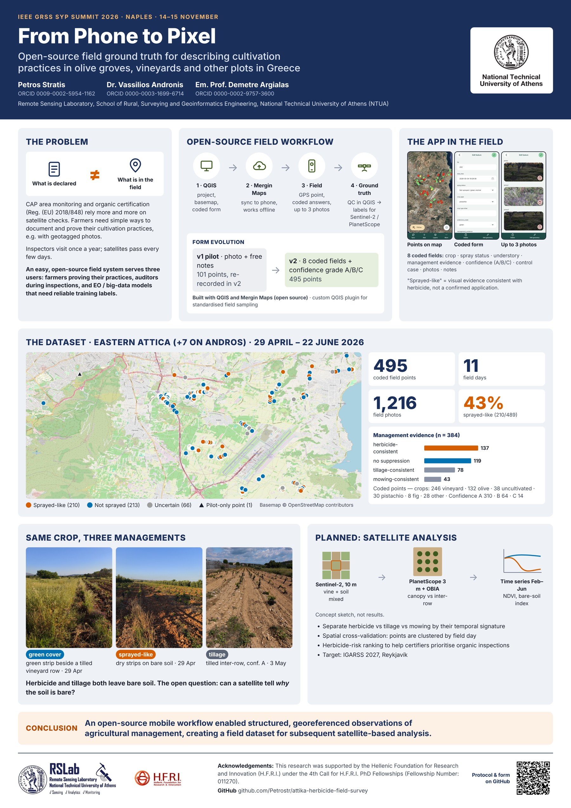

# Poster

[← Back to overview](README.md)

**From Phone to Pixel: open-source field ground truth for describing cultivation practices in olive groves, vineyards and other plots in Greece**

Petros Stratis · Dr. Vassilios Andronis · Em. Prof. Demetre Argialas

Presented at the IEEE GRSS Student and Young Professionals Summit 2026, Naples, 14–15 November 2026.

**[Download the poster as PDF (A1)](Naples_poster_A1.pdf)**

